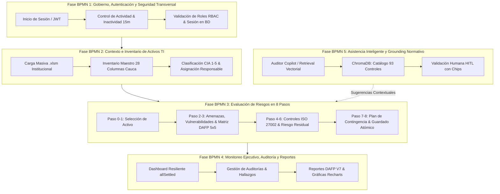

# SMARTAUDITORIA TI3 — ANÁLISIS DE CORRESPONDENCIA CON SMART BPMN Y AUDITORÍA DE MATRICES
**Maestría en Computación para el Desarrollo de Aplicaciones Inteligentes**  
**Universidad del Valle — Facultad de Ingeniería**  
**Autor:** Ing. Leonardo Javier Bastidas Moreno  
**Corte Académico:** 20 de noviembre de 2026 — Gate G0.5-QC  

---

## 1. Arquitectura del Flujo de Valor Smart BPMN Aprobado

El sistema **SmartAuditorIA** articula sus capacidades funcionales mediante un modelo de procesos de negocio inteligente (**Smart BPMN**) estructurado en **5 Fases / Carriles Operativos**, alineado con la norma **ISO/IEC 27001:2022**, el catálogo de **93 controles de ISO/IEC 27002:2022**, la guía de gestión de riesgos **DAFP V7 / MIPG** y la **Ley 1712 de 2014**:

---

## 2. Mapa de Correspondencia: Carriles BPMN $\rightarrow$ Historias TI3 $\rightarrow$ Componentes

| Fase Smart BPMN | Historias Base (TI1 / TI2) | Historias TI3 (V4.0) Vinculadas | Componentes Frontend (React / TS) | Servicios Backend (Flask / REST) | Almacenamiento & Persistencia |
| :--- | :--- | :--- | :--- | :--- | :--- |
| **Fase 1: Gobierno, Autenticación y Sesión Segura** | `HU-001` (SCRUM-10), `HU-007` (SCRUM-34), `HU-008` (SCRUM-35), `HU-019` (SCRUM-36) | **`HU-031`** (Sesión e Inactividad en Servidor) **`HU-033`** (Resiliencia SPA & ErrorBoundary) | `AuthContext.tsx`, `IdleTimeoutModal.tsx`, `RouteErrorBoundary.tsx`, `Layout.tsx` | `app/auth/routes.py`, `app/auth/decorators.py` (`@require_auth`) | **MariaDB 10.11 / MySQL** (Tabla `sesiones_usuario`, `usuarios_auth`, `roles`) |
| **Fase 2: Inventario de Activos de Información (MIPG / DAFP)** | `HU-002` (SCRUM-11), `HU-003` (SCRUM-21), `HU-021` (SCRUM-38), `HU-025` (SCRUM-42) | **`HU-034`** (Parser multi-hoja `.xlsm`) **`HU-037`** (28 Columnas Cauca, escala CIA 1–5) | `pages/activos/Activos.tsx`, `ActivoDetailCard.tsx` | `app/routes/activos.py`, `app/services/bulk_upload_service.py` | **MariaDB 10.11 / MySQL** (Tabla `activos_informacion`) |
| **Fase 3: Evaluación de Riesgos en 8 Pasos (ISO 27005 / DAFP V7)** | `HU-004` (SCRUM-22), `HU-006` (SCRUM-25), `HU-012` (SCRUM-22), `HU-022..024` (SCRUM-39..41) | **`HU-036`** (Matriz Riesgos DAFP 5x5) **`HU-039`** (Wizard Integral 8 pasos & validación) | `pages/wizard/RiskAssessmentWizard.tsx`, `RiskMatrix4x5.tsx`, `EditableActionPlan.tsx` | `app/routes/evaluaciones.py`, `app/domain/entities.py` | **MariaDB 10.11 / MySQL** (Tablas `evaluaciones_riesgo`, `riesgos`, `planes_accion`) |
| **Fase 4: Monitoreo Ejecutivo, Auditoría y Reportes (ISO 27001 Cl. 9-10)** | `HU-005` (SCRUM-23), `HU-013..015` (SCRUM-23..25), `HU-020` (SCRUM-37) | **`HU-035`** (Paneles allSettled y salud) **`HU-038`** (Auditorías REST & modales) **`HU-040`** (Filtros y gráficos Recharts) | `pages/dashboard/Dashboard.tsx`, `pages/auditoria/Auditorias.tsx`, `InformeRiesgos.tsx` | `app/routes/auditorias.py`, `app/routes/dashboard.py`, `app/routes/reportes.py` | **MariaDB 10.11 / MySQL** (Tablas `auditorias`, `hallazgos_auditoria`) |
| **Fase 5: Asistencia Inteligente y Grounding Normativo (RAG)** | `HU-009..011` (SCRUM-26..28), `HU-101..203` (SCRUM-29..34) | **`SCRUM-47`** (Re-indexación 93 controles ISO en ChromaDB) | `ConversationalAuditor.tsx`, `useWizardAI.ts`, `WizardAIMessageService.ts` | `smartauditoria_engine/rag_pipeline.py`, `gemini_cag_service.py` | **ChromaDB 0.5.3** (Colección `iso27002_controls_2022`) |

---

## 3. Auditoría Forense de la Matriz de Riesgos: Aprobada vs. Implementada

Se realizó una contrastación técnica exhaustiva entre la normativa institucional, el diseño Smart BPMN y el código fuente actualmente en producción:

| Dimensión Técnica | Matriz Aprobada (DAFP Versión 7 / ISO 27005) | Matriz Implementada en Dashboard (`RiskMatrix4x5.tsx`) | Matriz Implementada en Común (`RiskMatrix.tsx`) | Estado / Brecha Identificada |
| :--- | :--- | :--- | :--- | :--- |
| **Dimensiones** | **$5 \times 5$ (25 celdas):** - 5 Probabilidades: Raro (1), Improbable (2), Posible (3), Probable (4), Casi Seguro (5). - 5 Impactos: Insignificante (1), Menor (2), Moderado (3), Mayor (4), Catastrófico (5). | **$4 \times 5$ (20 celdas):** - 4 Probabilidades: Frecuente, Ocasional, Posible, Improbable. - 5 Impactos: Insignificante, Menor, Moderado, Mayor, Catastrófico. *(Omite el nivel 'Probable')*. | **$5 \times 5$ (25 celdas):** - 5 Probabilidades: Frecuente, Probable, Ocasional, Posible, Improbable. - 5 Impactos: Insignificante a Catastrófico. | ⚠️ **Divergencia Activa:** El Dashboard opera en $4\times 5$ mientras el Wizard y componentes comunes usan $5\times 5$. |
| **Zonas de Severidad** | **4 Zonas Oficiales:** - Zona de Riesgo Baja (Verde) - Zona de Riesgo Moderada (Amarillo) - Zona de Riesgo Alta (Naranja) - Zona de Riesgo Extrema (Rojo) | **3 Zonas:** - `BAJO` (`#27AE60`) - `MEDIO` (`#FACC15`) - `ALTO` (`#D9534F`) | **3 Zonas:** - `LOW` (`#10B981`) - `MEDIUM` (`#F59E0B`) - `HIGH` (`#EF4444`) | ⚠️ **Simplificación:** No se implementó la distinción entre riesgo "Alto" y "Extremo" / "Moderado". |
| **Comportamiento Responsive** | Visualización fluida sin scroll horizontal forzado en resoluciones de laptops de operadores ($1366 \times 768$). | **Ancho rígido:** Sufre de desborde horizontal forzando scroll (`DAS-01`). | Componente estático con visualización básica. | ⚠️ **Defecto de Usabilidad (`DAS-01`):** Desborde en pantallas de operadores. |
| **Solución en Backlog TI3** | **Homologación Oficial:** Componente unificado y responsivo de Matriz $5 \times 5$ DAFP V7. | **Plan de Reemplazo:** Sustituir `RiskMatrix4x5` por el nuevo componente común. | **Plan de Reemplazo:** Unificar estilos e interacción en una sola fuente de verdad. | 🎯 **Resuelto en `HU-036` (Sprint 10, 5 SP):** Unificación de componente sin desborde. |

---

## 4. Verificación de Persistencia y Bases de Datos
* **Capa Relacional Real:** **MariaDB 10.11 / MySQL (3306)** en contenedor Docker oficial `smartauditoria_db`.
* **Capa Vectorial Real:** **ChromaDB 0.5.3 (8000)** con persistencia en `./data/chroma`.
* **Testing Local:** **SQLite 3** para aislamiento de tests unitarios rápidos.
* *(Nota de Rectificación: Se descarta formalmente PostgreSQL por ser un error de documentación histórico que no refleja la configuración de `docker-compose.yml` ni `app/config.py`)*.
