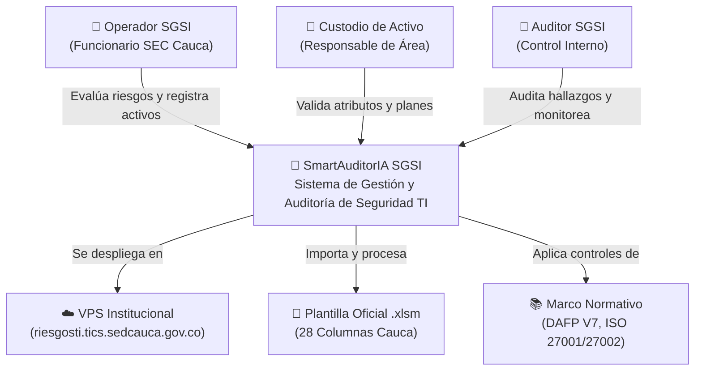
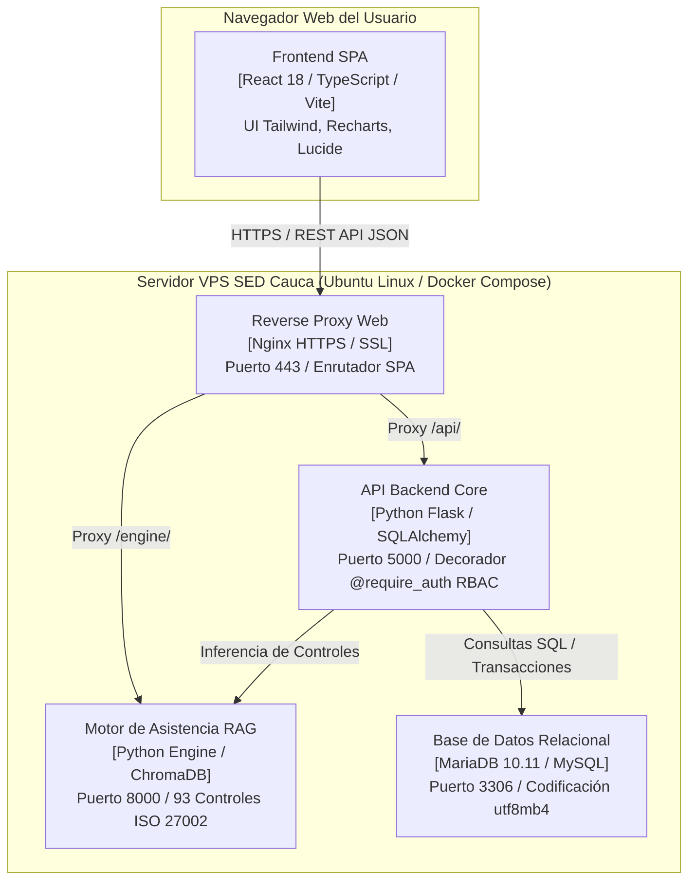

# SMARTAUDITORIA TI3 — AUDITORÍA SEMÁNTICA BPMN 2.0, MODELO DE PROCESOS Y ARQUITECTURA C4
**Maestría en Computación para el Desarrollo de Aplicaciones Inteligentes**  
**Universidad del Valle — Facultad de Ingeniería**  
**Autor:** Ing. Leonardo Javier Bastidas Moreno  
**Corte Académico:** 20 de noviembre de 2026 — Avance 1 (V4.0-TI3)  
**Entidad Beneficiaria:** Secretaría de Educación y Cultura — Gobernación del Cauca  

---

## 1. Inventario de Diagramas Originales y Dictamen de Validez

Se realizó una inspección exhaustiva de todo el repositorio `smartauditoria_project`, localizando todos los modelos gráficos generados en las fases TI2 y TI3.

### Inventario y Dictamen Técnico

| # | Archivo / Ubicación | Título Original | Formato | Naturaleza Real del Modelo | Dictamen BPMN 2.0 |
|---|---|---|---|---|---|
| **1** | [`docs/ENTREGA_PROYECTO_FINAL.md`](../../docs/ENTREGA_PROYECTO_FINAL.md#L45-L65) (Diag. 1) | Representación del Modelo Espiral de Ingeniería | Mermaid `graph TD` | Metodología de desarrollo de software (Scrum / SDLC). | ❌ **NO ES BPMN.** Corresponde a gestión de proyectos de ingeniería. |
| **2** | [`docs/ENTREGA_PROYECTO_FINAL.md`](../../docs/ENTREGA_PROYECTO_FINAL.md#L120-L150) (Diag. 2) | Diagrama de Arquitectura de Componentes | Mermaid `graph TB` | Arquitectura de software por capas (React, FastAPI, RAG, DB). | ❌ **NO ES BPMN.** Corresponde a Diagrama C4 de Contenedores/Componentes. |
| **3** | [`docs/ENTREGA_PROYECTO_FINAL.md`](../../docs/ENTREGA_PROYECTO_FINAL.md#L180-L205) (Diag. 3) | Diagrama de Interacción del Pipeline ETL GLPI | Mermaid `sequenceDiagram` | Secuencia técnica de sincronización de datos de activos. | ❌ **NO ES BPMN.** Corresponde a UML Sequence Diagram técnico. |
| **4** | [`docs/ENTREGA_PROYECTO_FINAL.md`](../../docs/ENTREGA_PROYECTO_FINAL.md#L230-L270) (Diag. 4) | Diagrama de Base de Datos Relacional | Mermaid `erDiagram` | Modelo Entidad-Relación de persistencia de datos. | ❌ **NO ES BPMN.** Corresponde a modelo ER de base de datos. |
| **5** | [`docs/ENTREGA_PROYECTO_FINAL.md`](../../docs/ENTREGA_PROYECTO_FINAL.md#L310-L330) (Diag. 5) | Flujo de Trabajo del Wizard de Evaluación | Mermaid `stateDiagram-v2` | Máquina de estados de la interfaz de usuario (5 pasos TI2). | ❌ **NO ES BPMN.** Es un diagrama de estados de UI; además está desactualizado frente a los 8 pasos reales. |
| **6** | [`docs/ENTREGA_PROYECTO_FINAL.md`](../../docs/ENTREGA_PROYECTO_FINAL.md#L340-L370) (Diag. 6) | Diagrama de Secuencia: Evaluación con RAG | Mermaid `sequenceDiagram` | Interacción cliente-servidor con motor RAG de embeddings. | ❌ **NO ES BPMN.** Corresponde a UML Sequence Diagram técnico. |
| **7** | [`docs/ti3/avance_1/ANALISIS_SMART_BPMN.md`](../../docs/ti3/avance_1/ANALISIS_SMART_BPMN.md#L12-L40) | Arquitectura del Flujo de Valor Smart BPMN | Mermaid `flowchart TD` | Diagrama de flujo en 5 subgrafos que agrupaba módulos. | ⚠️ **BPMN INVÁLIDO.** Carece de eventos formales, no diferencia User Tasks de Service Tasks ni compuertas de decisión. |

> [!CAUTION]
> **Conclusión de la Auditoría Inicial:** En los repositorios históricos de TI2 **NO existía ningún archivo `.bpmn` o `.drawio` nativo ni diagrama BPMN 2.0 semánticamente válido**. Los diagramas anteriores denominados informalmente "BPMN" eran en realidad diagramas de flujo genéricos (`flowchart`) o de arquitectura de componentes. Por tanto, no se puede afirmar que un diagrama BPMN estuviera formalmente aprobado bajo el estándar BPMN 2.0.

---

## 2. Modelo de Procesos de Negocio del SGSI (AS-IS vs. TO-BE)

> [!NOTE]
> **Regularización Semántica del Modelo de Procesos:**
> El diagrama Mermaid a continuación constituye el **Modelo Conceptual de Procesos (Notación BPMN)** para el SGSI. El archivo formal estandarizado bajo la especificación BPMN 2.0 (ISO/IEC 19510) validable en herramientas como Camunda o BPMN.io se encuentra disponible en: [`proceso_sgsi_operativo.bpmn`](proceso_sgsi_operativo.bpmn).
> 
> Se diferencia estrictamente el **estado actual implementado en código (AS-IS)** de las **metas de la iteración final (TO-BE)**. No se asumen como terminadas integraciones o aprobaciones cuya implementación en código no haya sido verificada.

Para corregir la ambigüedad y separar estrictamente el **proceso de negocio del SGSI** de la arquitectura de software, se define a continuación el modelo de procesos de negocio formal bajo la especificación **BPMN 2.0 (ISO/IEC 19510)**.

### Pool Principal: Proceso Operativo de Gestión de Seguridad y Evaluación de Riesgos TI (SGSI)
El proceso representa el ciclo de vida operativo que siguen los funcionarios de la Secretaría de Educación y Cultura de la Gobernación del Cauca para gestionar activos, evaluar riesgos y auditar la seguridad.

```mermaid
flowchart TD
    subgraph Pool["POOL: Sistema de Gestión de Seguridad de la Información (SGSI — SmartAuditorIA)"]
        
        subgraph Lane_Operador["Carril: Operador / Evaluador de Seguridad SGSI"]
            Start_Ev["Inicio: Detección de Necesidad de Evaluación"] --> Task_Login["1. Iniciar Sesión en Portal SGSI"]
            Task_Login --> Task_SelectActivo["2. Seleccionar Activo o Importar .xlsm"]
            Task_SelectActivo --> Task_ThreatVuln["3. Identificar Amenazas y Vulnerabilidades"]
            Task_ThreatVuln --> Task_InherentRisk["4. Estimar Probabilidad e Impacto (5x5)"]
            Task_InherentRisk --> Task_SelectControls["5. Seleccionar Controles ISO 27002"]
            Task_SelectControls --> Task_ResidualRisk["6. Estimar Eficacia y Riesgo Residual"]
            Task_ResidualRisk --> Gateway_Risk["¿Riesgo Residual Aceptable según Apetito?"]
            Gateway_Risk -- "Sí" --> Task_AcceptRisk["7a. Definir Tratamiento: Aceptar"]
            Gateway_Risk -- "No" --> Task_MitigateRisk["7b. Definir Tratamiento: Mitigar / Transferir / Evitar"]
            Task_AcceptRisk --> Task_ActionPlan["8. Formular Plan de Acción y Contingencia"]
            Task_MitigateRisk --> Task_ActionPlan
            Task_ActionPlan --> Task_ReviewReport["9. Revisar Resumen y Solicitar Validación"]
        end

        subgraph Lane_Custodio["Carril: Custodio / Responsable del Activo"]
            Task_SelectActivo -.-> Task_ValidateAsset["Validar Atributos Ficha 28 Cols"]
            Task_ValidateAsset --> Task_ConfirmCIA["Validar Criticidad CIA (1-5)"]
            Task_ConfirmCIA -.-> Task_ThreatVuln
            Task_ReviewReport --> Task_ApprovePlan["Validar Factibilidad del Plan de Acción"]
        end

        subgraph Lane_Auditor["Carril: Auditor Interno / Administrador SGSI"]
            Task_ApprovePlan --> Task_AuditReview["Monitorear Mapa de Calor y Dashboard"]
            Task_AuditReview --> Task_AuditCheck["Ejecutar Auditoría Periódica de Cumplimiento"]
            Task_AuditCheck --> Task_Findings["Registrar Hallazgos (No Conformidades)"]
            Task_Findings --> End_Ev["Fin: Evaluación y Auditoría Certificada SGSI"]
        end

        subgraph Lane_Servicios["Carril: Tareas Automatizadas de Servicio (SmartAuditorIA)"]
            Svc_Auth["[Service Task] Validar JWT, Roles RBAC & Sesión BD"]
            Svc_SessionTimer["[Service Task] Monitorear Inactividad (15m) & Revocar"]
            Svc_Parser["[Service Task] Parsear .xlsm multi-hoja por lotes"]
            Svc_CIACalc["[Service Task] Calcular Promedio CIA 1-5"]
            Svc_RAG["[Service Task] Consultar ChromaDB: 93 Controles ISO"]
            Svc_MatrixCalc["[Service Task] Calcular Zona Matriz DAFP 5x5"]
            Svc_AtomicSave["[Service Task] Guardado Atómico en MariaDB"]
        end

    end

    Task_Login <--> Svc_Auth
    Task_Login -.-> Svc_SessionTimer
    Task_SelectActivo <--> Svc_Parser
    Task_ConfirmCIA <--> Svc_CIACalc
    Task_SelectControls <--> Svc_RAG
    Task_InherentRisk <--> Svc_MatrixCalc
    Task_ResidualRisk <--> Svc_MatrixCalc
    Task_ReviewReport <--> Svc_AtomicSave
```

---

## 3. Desglose de Procesos Funcionales Clave

### A. Gestión e Inventario de Activos de Información
* **Actores:** Operador SGSI (registro/importación) y Custodio del Activo (validación técnica y de propiedad).
* **Entradas:** Plantilla oficial institucional `.xlsm` con macros (Gobernación del Cauca) o ingreso manual.
* **Flujo Operativo:**
  1. El operador carga el archivo `.xlsm`.
  2. La **Tarea de Servicio** valida tamaño (<50MB), hoja oficial `1. ACTIVOS DE INFORMACIÓN` y consistencia de encabezados.
  3. Se extraen las 28 columnas institucionales (Secretaría, Grupo Interno, Marca, Modelo, Serie, etc.).
  4. El custodio valida la valoración de Confidencialidad, Integridad y Disponibilidad (escala 1 a 5).
  5. La **Tarea de Servicio** calcula automáticamente el promedio CIA y el nivel de criticidad del activo.
* **Salida / Objeto de Datos:** Registro en tabla `activos_informacion` (MariaDB 10.11) con estado activo.

### B. Evaluación de Riesgos (Wizard Secuencial de 8 Pasos)
* **Actores:** Operador / Evaluador SGSI con asistencia automatizada HITL (Human-in-the-Loop).
* **Flujo Operativo:**
  * **Paso 0-1 (Activo):** Selección obligatoria del activo a evaluar. Bloqueo estricto si no hay activo seleccionado (`HU-033`).
  * **Paso 1-2 (Riesgo):** Selección de amenaza y vulnerabilidad vinculadas (`HU-039`).
  * **Paso 2-3 (Inherente):** Valoración de probabilidad e impacto (1 a 5). Cálculo en la matriz oficial DAFP V7 de 5×5 (`HU-036`).
  * **Paso 3-4 (Controles):** Consulta contextual a la **Tarea de Servicio RAG** (ChromaDB 0.5.3) para obtener recomendaciones de los 93 controles ISO 27002:2022. Valoración de eficacia.
  * **Paso 4-5 (Residual):** Cálculo automático del riesgo residual tras la mitigación del control.
  * **Paso 5-6 (Tratamiento):** Compuerta de decisión exclusiva: Mitigar, Aceptar, Transferir o Evitar.
  * **Paso 6-7 (Plan de Acción):** Definición de tareas, responsables, presupuesto y cronograma (`EditableActionPlan.tsx`).
  * **Paso 7-8 (Resultados):** Visualización consolidada, exportación a PDF/Excel y guardado atómico transaccional (`HU-039`).

### C. Auditoría y Seguimiento Continuo
* **Actores:** Auditor Interno SGSI / Administrador del Sistema.
* **Flujo Operativo:**
  1. Monitoreo del Dashboard ejecutivo con carga desacoplada `allSettled` (`HU-035`).
  2. Acceso al módulo de Auditoría con control de acceso basado en roles (RBAC) (`HU-038`).
  3. Consulta y edición de hallazgos mediante endpoints REST `GET /api/auditorias/<id>` y `PUT /api/auditorias/<id>`.
  4. Generación de informes normativos con gráficos Recharts con porcentajes y totales (`HU-040`).

---

## 4. Diagrama Arquitectónico C4 Diferenciado (No BPMN)

Para cumplir estrictamente la regla de **no mezclar arquitectura técnica con procesos de negocio**, se presenta a continuación el modelo de arquitectura C4:

### C4 — Nivel 1: Diagrama de Contexto del Sistema

### C4 — Nivel 2: Diagrama de Contenedores de Software

---

## 5. Matriz de Trazabilidad: Proceso BPMN $
ightarrow$ Módulos $
ightarrow$ Jira Cloud $
ightarrow$ Calidad

| Subproceso / Actividad BPMN 2.0 | Tipo de Tarea | Módulo Técnico Afectado | Issue Jira Oficial | Estado en TI3 | Criterio de Calidad & Prueba |
| :--- | :---: | :--- | :---: | :---: | :--- |
| **Control de Sesión por Inactividad (15 min)** | User / Service | `AuthContext.tsx`, `IdleTimeoutModal.tsx`, `@require_auth` | **`SCRUM-52`** (`HU-031`) | En Validación Local | `test_auth_session_revocation.py` (Pytest) & `auth_idle.test.tsx` (Vitest). |
| **Saneamiento Tipográfico y Ortografía** | User Interface | 11 archivos TSX, `EditableActionPlan.tsx` | **`SCRUM-53`** (`HU-032`) | En Validación Local | Guardián `utf8_orthography.test.ts` (0 mojibake en frontend). |
| **Navegación Fluida SPA y Bloqueo Paso 0** | User / Service | `RouteErrorBoundary.tsx`, `RiskAssessmentWizard.tsx` | **`SCRUM-54`** (`HU-033`) | En Validación Local | `RouteErrorBoundary.test.tsx` & función pura `getEvaluacionEstado`. |
| **Carga Masiva .xlsm 28 Columnas** | Service Task | `importacion.py`, parser openpyxl | **`SCRUM-55`** (`HU-034`) | Planificada S9 | Soporte hoja `1. ACTIVOS DE INFORMACIÓN`, límite 50MB y log por fila. |
| **Dashboard Desacoplado de Monitoreo** | User Interface | `Dashboard.tsx`, `Riesgos.tsx` | **`SCRUM-56`** (`HU-035`) | Planificada S9 | `Promise.allSettled`, cero bucles de re-render y categorías MIPG. |
| **Valoración en Matriz DAFP 5x5 Responsiva** | User / Service | `RiskMatrix5x5.tsx` | **`SCRUM-57`** (`HU-036`) | Planificada S10 | Matriz 5x5 (25 celdas) DAFP V7 sin scroll horizontal en 1366×768. |
| **Homologación de Activos 28 Cols & CIA** | User / Service | Modelo `ActivoInformacion`, `Activos.tsx` | **`SCRUM-58`** (`HU-037`) | Planificada S10 | 28 columnas Cauca, promedio CIA 1-5 y selector predictivo. |
| **Paginación, Chips y Leyendas de Reportes** | User Interface | `InformeRiesgos.tsx`, `TendenciasSeguridad.tsx` | **`SCRUM-61`** (`HU-040`) | Planificada S10 | Paginación en Paso 1, chips de filtro y Recharts con porcentajes. |
| **Auditoría REST y Control de Hallazgos** | User / Service | Endpoints `GET/PUT /api/auditorias/<id>`, modales | **`SCRUM-59`** (`HU-038`) | Planificada S11 | Operatividad REST, modal de edición de hallazgos y roles RBAC. |
| **Endurecimiento Wizard 8 Pasos y Guardado** | User / Service | `RiskAssessmentWizard.tsx`, API guardado atómico | **`SCRUM-60`** (`HU-039`) | Planificada S11 | Bloqueo secuencial pasos 1 a 6, debounce sin auto-scroll y vínculo ISO. |

---

## 6. Discrepancias Técnicas Detectadas (AS-IS vs. TO-BE)

| # | Elemento | Estado Actual (AS-IS) | Estado Objetivo (TO-BE V4.0) | Historia de Regularización |
|---|---|---|---|:---:|
| **1** | **Matriz de Riesgos en Dashboard** | Componente `RiskMatrix4x5.tsx` de 4 probabilidades × 5 impactos (20 celdas, 3 niveles, omite 'Probable') con ancho fijo desbordado en laptops. | Componente unificado `RiskMatrix5x5.tsx` de 5 probabilidades × 5 impactos (25 celdas, 4 zonas DAFP V7) con grilla CSS responsiva sin scroll horizontal. | `SCRUM-57` (`HU-036`) |
| **2** | **Motor de Base de Datos Documentado** | Documentos históricos de TI2 mencionaban PostgreSQL. En el entorno real opera MariaDB 10.11 / MySQL en puerto 3306. | Documentación técnica regularizada reflejando estrictamente **MariaDB 10.11 / MySQL** con `utf8mb4`. | Regularizado en Avance 1 / TI3 |
| **3** | **Carga de Plantilla de Activos** | Endpoint anterior esperaba archivos `.xlsx` simples y fallaba con macros o archivos de 50MB. | Parser inteligente para `.xlsm` institucional que localiza la hoja `1. ACTIVOS DE INFORMACIÓN` y procesa lotes transaccionales con reporte de errores. | `SCRUM-55` (`HU-034`) |
| **4** | **Módulo de Auditorías** | Interfaz con botones visuales pero sin endpoints REST dedicados de detalle o actualización. | Endpoints REST formales `GET /api/auditorias/<id>` y `PUT /api/auditorias/<id>` con RBAC y modales funcionales. | `SCRUM-59` (`HU-038`) |
| **5** | **Wizard de Evaluación** | Cálculo de estado con efectos colaterales dentro de render y falta de validación estricta de obligatorios entre pasos. | Función pura `getEvaluacionEstado`, bloqueo secuencial sin activo o campos obligatorios y guardado atómico consolidado. | `SCRUM-54` / `SCRUM-60` |
